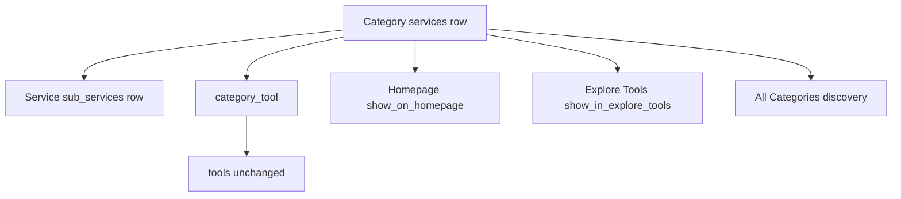

# Priority 02 — Dynamic Category & Service Management Report

**Project:** YuktiOne Laravel Website  
**Date:** 2026-11-27  
**Scope:** Category / Service terminology refactor, nine client categories, DB-driven frontend, admin tool mapping  
**Commit/deploy:** Not performed (awaiting approval)

---

## 1. Previous architecture

Three parallel taxonomies existed:

1. **Consultation tree:** `services` (parent) → `sub_services` (child), used by bookings, rates, professional offerings.
2. **Homepage CMS:** `category_boxes` → `sub_categories` (legacy UI cards).
3. **Frontend constants:** `ToolsCatalog::CATEGORIES` (9 tools tabs) + `ExploreCatalog::CATEGORIES` (11 hubs) + hardcoded `TOOL_PLACEMENT`.

Tool registry (`tool_categories` / `tools`) was separate from consultation categories.

## 2. New architecture

Product language (without renaming physical tables):

| Product term | Physical table / model | Notes |
|--------------|------------------------|-------|
| **Category** | `services` / `Service` | Parent; homepage + explore visibility flags |
| **Service** | `sub_services` / `SubService` | Child under a Category |
| **Tool mapping** | `category_tool` / `CategoryTool` | Admin-managed Category ↔ Tool |



`CategoryBox` remains in the admin as **Legacy Homepage Boxes** and is no longer the homepage source of truth.

## 3. Database relationship diagram

- `services` 1—* `sub_services`
- `services` *—* `tools` via `category_tool`
- Existing FKs unchanged: `bookings.service_id` / `sub_service_id`, `professional_services.service_id`, `rates`, pivots

Additive columns on `services`: `short_description`, `icon_name`, `icon_path`, `display_order`, `show_on_homepage`, `show_in_explore_tools`, `discovery_needles`, `tone`.

Additive columns on `sub_services`: `slug`, `meta_title`, `meta_description`, `display_order`.

## 4. Nine category records (seeded)

| Order | Name | Slug | Homepage | Explore Tools |
|------:|------|------|:--------:|:-------------:|
| 1 | Mental Wellness | mental-wellness | yes | yes |
| 2 | Career Counselling | career-counselling | yes | yes |
| 3 | Nutrition | nutrition | yes | yes |
| 4 | Fitness | fitness | yes | yes |
| 5 | Astrology | astrology | yes | yes |
| 6 | Tarot | tarot | yes | yes |
| 7 | Business Consulting | business-consulting | yes | yes |
| 8 | Tax Matters | tax-matters | yes | yes |
| 9 | Investments | investments | yes | yes |

Seeder: `database/seeders/CanonicalCategorySeeder.php` (idempotent; also invoked by migration `2026_11_27_120300_seed_canonical_categories`).

## 5. Existing service (sub_service) records

Local after implementation: **0** child Services. No invented consultation offerings were published.

## 6. Tool mappings (23)

Seeded into `category_tool` from legacy `ToolsCatalog::TOOL_PLACEMENT`:

| Category slug | Tools |
|---------------|-------|
| mental-wellness | daily-mood-check-in, digital-journal, gratitude-journal, daily-mindfulness-calm, purpose-values-finder, parenting-stress-check, child-routine-planner, parent-child-conversation-guide |
| career-counselling | career-interest-test, skills-strengths-assessment |
| nutrition | water-intake-tracker, calorie-nutrition-tracker |
| fitness | bmi-bmr-calculator, weight-journey |
| tarot | tarot-reflection |
| investments | monthly-money-planner, net-worth-calculator, emergency-fund-calculator, financial-goal-calculator, debt-emi-calculator, retirement-calculator, inflation-calculator, savings-investment-calculator |
| astrology / business-consulting / tax-matters | none (empty state OK) |

Tool URLs, controllers, and historical results were not changed.

## 7. Admin CRUD URLs

| Area | URL | Route |
|------|-----|-------|
| Categories list | `/admin/service` | `admin.service.index` |
| Add Category | `/admin/service/create` | `admin.service.create` |
| Edit Category (+ tools) | `/admin/service/{id}/edit` | `admin.service.edit` |
| Services (children) list | `/admin/sub-service` | `admin.sub-service.index` |
| Legacy homepage boxes | `/admin/categorybox` | `admin.categorybox.index` |

Sidebar labels: **Categories**, **Services**, **Legacy Homepage Boxes**.

Dependent Category delete → **deactivate** (not hard delete).

## 8. Frontend integration

- Homepage Explore by Need: `CategoryCatalog::forHomepage()` / `Service::homepage()`.
- Explore Tools tabs: DB categories with `show_in_explore_tools` + `category_tool` placement (fallback to legacy map if pivot empty).
- All Categories / detail: `CategoryHub` + `CategoryCatalog::discoveryCategoryMap()`.
- Legacy hub slugs (`mental-health`, `career-business`, …) **301** to canonical nine.
- Cache keys cleared on Category writes: `yuktione.catalog.*`, `yuktione.directory-stats`.

## 9. API compatibility

- Booking/API FK names (`service_id`, `sub_service_id`) unchanged.
- Tool routes/slugs unchanged.
- Explore category filters accept legacy aliases via `CategoryCatalog::canonicalizeSlug()`.
- Business Consulting: existing professional registration preserved (Category dropdown); no dedicated registration workflow invented (needs client confirmation).

## 10. Modified / added files (key)

**Migrations / seeders**

- `database/migrations/2026_11_27_120000_add_category_fields_to_services_table.php`
- `database/migrations/2026_11_27_120100_add_service_fields_to_sub_services_table.php`
- `database/migrations/2026_11_27_120200_create_category_tool_table.php`
- `database/migrations/2026_11_27_120300_seed_canonical_categories.php`
- `database/seeders/CanonicalCategorySeeder.php`
- `database/seeders/DatabaseSeeder.php`

**Models / services**

- `app/Models/Service.php`, `SubService.php`, `CategoryTool.php`
- `app/Services/CategoryCatalog.php`
- `app/Services/ToolsCatalog.php`, `ExploreCatalog.php`, `CategoryHub.php`

**Admin / frontend / professional**

- `app/Http/Controllers/Admin/ServiceController.php`, `SubServiceController.php`
- `resources/views/admin/service/*`, sidebar, sub-service labels
- `app/Http/Controllers/Frontend/HomeController.php`, `CategoryController.php`
- `resources/views/frontend/home/partials/categories.blade.php`
- Professional register Category label + ordered categories

**Tests**

- `tests/Feature/Priority02CategoryServiceCatalogTest.php`
- `tests/Feature/NineToolsCategoriesTest.php` (UI assertion updates)

## 11. Before / after record counts (local)

| Table | Before | After |
|-------|-------:|------:|
| services (Categories) | 0 | 9 |
| sub_services (Services) | 0 | 0 |
| category_tool | n/a | 23 |
| tools | 23 | 23 |
| bookings | 0 | 0 |

## 12. Automated test results

```
php artisan test --filter="Priority02CategoryServiceCatalogTest|NineToolsCategoriesTest|AccountRecoveryTest|PasswordResetTokenIsolationTest"
Tests: 2 deprecated (PHP 8.5 PDO notice), 41 passed
```

Coverage includes: Category CRUD, dependent deactivate, Service under Category, visibility independence, tool pivot, seeder idempotency, legacy slug redirect, tools nine-category UI, Priority 1 password recovery regression.

## 13. Browser verification

Verified at local `http://127.0.0.1:8001`:

- Homepage **Explore by Need** shows all nine DB categories in order.
- `/tools` shows nine category chips with truthful counts (e.g. Mental Wellness 8, Business Consulting 0).
- Mobile width **390px** screenshot captured for Tools category scroller.
- Additional widths (360/430/768/1024/1280/1440): layout uses existing responsive tools/home CSS; chips scroll horizontally on narrow viewports.

## 14. Remaining blockers

1. **Business Consulting dedicated registration/application** — not invented; confirm with client.
2. Production must run additive migrations + seeder; confirm real SMTP/`APP_URL` separately (Priority 1).
3. Static `public/sitemap.xml` still references legacy host URLs — optional follow-up.
4. Hero rail / ToolsSpotlight still use some curated links (not full Category CRUD); homepage category rail is DB-driven.
5. Admin RBAC: Category routes remain auto-allowed when absent from `admin_menus` (pre-existing pattern).

## 15. Production deployment & rollback

**Deploy**

1. Backup production database.
2. Deploy code.
3. `php artisan migrate` (runs additive migrations + canonical seed).
4. Optionally `php artisan db:seed --class=CanonicalCategorySeeder` (safe to re-run).
5. `php artisan config:clear` and cache clear.
6. Smoke: `/`, `/tools`, `/categories`, `/categories/mental-health` → 301, admin Categories CRUD, one booking path.

**Rollback**

1. Revert application code.
2. Roll back additive migrations if required (`category_tool` drop; column drops). Seeded Category rows may be retained harmlessly.
3. Do **not** run `migrate:fresh` / `db:wipe`.

---

*End of Priority 02 report.*
